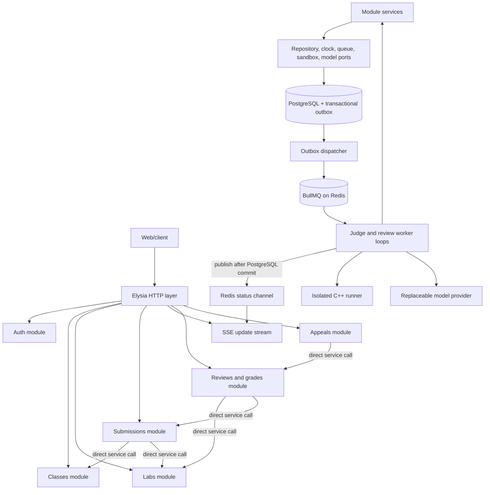

# LeeTKOB System Design

## 1. Overview

LeeTKOB is a modular monolith: one Bun/TypeScript application using Elysia 2.0 RC, one public API, and a set of modules with explicit ownership. Modules communicate with direct in-process function calls through narrow exported interfaces implemented by each module's service. There are no service-to-service HTTP calls or microservice assumptions in this design.

The system still uses asynchronous durable jobs for expensive or isolated work. “Modular monolith” describes the application and module boundaries; it does not mean compiling untrusted code in an HTTP request or in the API handler.

## 2. Logical architecture

The diagram shows logical dependencies, not a mandated repository layout. The selected application shape is a Bun/TypeScript/Elysia modular monolith, PostgreSQL source of truth, PostgreSQL transactional outbox, BullMQ workers on Redis, Docker-based isolated judging, and SSE for submission updates. The current PA2 project does not yet include the outbox dispatcher, queue, SSE endpoint, or worker consumers. Workers may initially run in the same deployable application, but outside request handling and through the same module interfaces. Redis/BullMQ is not the source of truth: committed outbox and domain state in PostgreSQL allow queue work to be redispatched after Redis loss. Workers publish status notifications only after committing state; SSE subscribers use PostgreSQL snapshots on connect/reconnect and Redis notifications for live updates.

## 3. Runtime layers

1. **HTTP composition:** `src/app.ts` composes route plugins, shared HTTP plugins, validation, SSE, and error mapping. `src/index.ts` validates startup configuration and starts listening. Importing the app for tests must not open a port.
2. **Controllers:** Elysia route plugins parse/validate transport data, obtain verified identity, call a service interface, and map domain outcomes to the endpoint's response contract. Do not pass the whole Elysia context to domain services.
3. **Module services:** implement each module's exported interface and enforce business rules, authorization ownership, and transaction boundaries.
4. **Adapters:** persistence, authentication, clock, durable queue, sandbox, and model provider implementations. Services depend on ports, not vendor SDKs or Elysia request context.
5. **Workers:** claim durable jobs, invoke the applicable service workflow/adapter, persist outcomes idempotently, and make retry state observable.

Elysia's feature-based organization, `app.ts` composition, separate listening entry point, runtime schemas, and service/controller separation are adopted as conventions. Schemas describe API DTOs and are not automatically the database schema. Keep response projections explicit so private fields cannot leak.

## 4. Module map and ownership

| Module | Owns | Main collaborators |
|---|---|---|
| Auth | Credential verification and authenticated principal projection | All HTTP modules; identity provider adapter. |
| Classes | Class, TA assignment, student membership, invite code | Auth, Labs. |
| Labs | Lab lifecycle, constraints/revisions, private tests and limits | Classes, Submissions, Review/Grades. |
| Submissions | Accepted submission records, counted-submission selection, student-safe result projection | Classes, Labs, Judging, Review/Grades. |
| Judging | Job lifecycle and judge result normalization | Submissions, Labs, Queue and sandbox adapters. |
| Constraint Review | Hard-check/model orchestration, proposal/evidence validation, sampling, spend | Labs, Submissions, Review/Grades, model adapter. |
| Reviews and Grades | TA decisions, final deductions, score calculation, publication | Labs, Submissions, Constraint Review, Audit. |
| Appeals | Appeal eligibility and decisions; score adjustment request | Reviews and Grades, Audit. |
| Audit | Append-only audit recording and authorized query policy | Modules that record consequential actions. |

Modules own their persistence queries. No module reads or writes another module's tables through a shared database client as a shortcut. A transaction coordinator may span repositories for a documented atomic use case, but it must not move ownership of the rules.

## 5. Core workflows

### 5.1 Submission and judging

The Submissions module authenticates the student, asks Classes and Labs to confirm membership and submission window, records server receipt time, persists a submission and durable judge job atomically (or through a documented outbox-equivalent), then acknowledges without waiting for compilation. The worker claims the job, retrieves only the necessary source/tests, calls the isolated runner, and records normalized verdicts. Repeated worker delivery must not duplicate results.

### 5.2 Constraint review

After deadline, the system selects the latest pre-deadline submission for each student. Only a counted Accepted submission is eligible. Hard checks run before any model request. The model adapter receives the lab statement, applicable constraints, and de-identified/comment-stripped code only. The review module validates structured output and source-line evidence, tracks cost against the per-lab cap, stores proposals as non-final, and queues every violation/unsure plus the required random pass sample.

### 5.3 Review and publication

TA decisions are stored as final `pass` or `violation`; violation requires exact evidence lines. The grade service derives deductions from confirmed violations and the lab's constraint values. Publish is a single lab-wide transition after the deadline, successful judging of every valid submission, completed constraint review for counted Accepted submissions, and all required TA decisions. Pending or failed judge jobs block publication until judging succeeds. Every class student receives a result; a student with no valid pre-deadline submission receives zero. The approved contract defines the exact endpoint response and idempotency. Publication does not prevent audited individual corrections through the supported appeal/correction paths.

## 6. Technology and deployment choices

| Concern | Current direction | Status |
|---|---|---|
| Runtime/language | Bun and TypeScript | Required project stack. |
| HTTP | Elysia 2.0 RC | Required project stack; follow documented feature-based patterns where applicable. |
| Database | PostgreSQL | Selected for the final product. |
| Durable work | PostgreSQL transactional outbox dispatches idempotent jobs to BullMQ on Redis; worker consumers execute judging/review | Selected for final product; not implemented in PA2. Configure Redis persistence, bounded concurrency, and recovery from PostgreSQL state. |
| C++ execution | Docker-based isolated runner | Selected approach; exact runner setup remains gated on proof of all required restrictions. |
| Live updates | SSE status stream plus GET snapshot | Selected; event replay is not required. Reconnect by fetching the current snapshot and reopening the stream. |
| Model | Structured-output provider behind adapter | Provider/model remain open; set provider-side and application spend ceiling. |
| Testing | `bun test`, deterministic fakes | No real model call in unit or contract tests. |

## 7. Architecture acceptance criteria

- A module consumer imports only another module's documented contract/interface, not its repository or table definitions.
- Services can be called without constructing an Elysia request context.
- Route validation and DTO types are runtime-backed; API schemas do not expose private database fields by reuse alone.
- `app.ts` can be imported in tests without listening on a port.
- Submission acknowledgement is independent of judge execution; jobs and retries are durable/idempotent.
- Untrusted C++ never runs in the API process with application secrets.
- Submission and outbox rows commit atomically in PostgreSQL; duplicate outbox delivery is safe and jobs can be recreated in BullMQ after Redis loss.
- Replacing persistence, auth, queue, runner, or model provider does not change domain rules or public API behavior.

## 8. References

- [Elysia best practices](https://next.elysiajs.com/essential/best-practice/)
- [Project proposal and FR/NFR IDs](../planning/project-proposal.md)
- [Module boundary rules](module_boundaries.md)
- [Database design](../database/db_design.md)
