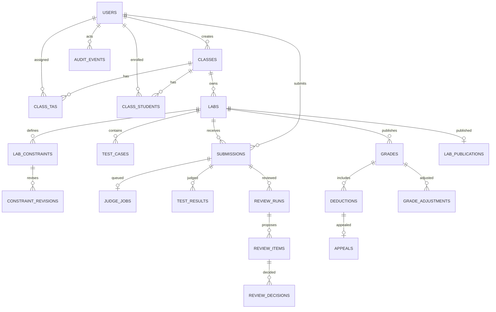

# LeeTKOB Database Design

## 1. Status

This is a review of the current Drizzle schema against the final product
workflows. The current model replaces the earlier proposal's separate
invitation-code table and external identity subject: users have local
email/password credentials, and each class stores its current invitation code
directly. It also declares records for judging, review, grading, appeals,
audit, and outbox work.

The table structure covers the main final-system workflows. The current
schema declares unique email and invitation-code indexes, and the auth service
stores normalized email addresses. Apply the matching migrations before
relying on those indexes in a deployed database. Invitation expiry is
specified only by the proposed invite-code API contract, not by the PA2/PA3
rubrics or FAQ; add an expiry field only if that behavior remains in the final
scope. Cross-record and time-dependent rules listed below must also be
enforced in transactional service logic or stronger database constraints.

The table catalog below describes the current Drizzle declarations, not yet an
approved final migration set. `src/db/db.ts` creates a Drizzle client over a
`pg` pool using `DATABASE_URL`. No migration files are currently present, so
the declarations do not establish that any deployed database has been brought
up to date. Once the required gaps are resolved, keep migrations in sync with
this reviewed model.

## 2. Entity relationships

`OUTBOX_EVENTS` references work by a stable `event_key` and `aggregate_id`;
its aggregate may identify a submission or another supported workflow object.

## 3. Table catalog

The TypeScript schema files are authoritative for exact column names and
Drizzle constraints.

| Table | Purpose and key declared fields |
|---|---|
| `users` | UUID ID, display name, unique normalized email, password hash, `ADMIN`/`TA`/`STU` role, `ACTIVE`/`DISABLED` status, timestamps. |
| `classes` | UUID ID, name, one current `invitation_code`, creator, timestamps, nullable archive time. The code is stored on the class; there is no invitation table. The current schema declares the code unique; an expiry timestamp is not included. |
| `class_tas` | Class/TA assignment history with assigning user, assignment time, and nullable revocation time. Partial unique index allows one active assignment per class/TA pair. |
| `class_students` | Class/student membership history with join actor/time and nullable leave time. Partial unique index allows one active membership per class/student pair. |
| `labs` | Class, title, statement, open/deadline times, CPU/memory limits, creator/editor. Checks require open before deadline, CPU 1–5 seconds, memory 64–512 MB. |
| `lab_constraints` | Lab-local constraint ID, current revision pointer, active flag, creation time. Composite primary key is `(lab_id, constraint_id)`. |
| `constraint_revisions` | Immutable revision number/text/deduction/change metadata for a lab constraint. Deduction is 0.01–10.00; revision number is positive and unique per constraint. |
| `test_cases` | Ordered private input and expected output bytes, unique by lab/test number. |
| `submissions` | Student/lab, idempotency key and request hash, source bytes/size/hash, server receipt time, judge state/verdict/completion. Unique idempotency key per student/lab; source size is 1–65,536 bytes. |
| `judge_jobs` | One job per submission, status, attempts, availability, lease, safe error code, and completion. Runnable and expired-lease indexes support worker claims. |
| `test_results` | One result per submission/test ordinal with verdict and optional execution/memory metrics. No test input/output columns are exposed here. |
| `review_runs` | Per-submission review attempt, status/method, provider/model, token/cost usage, safe failure code, and timestamps. |
| `review_items` | Per-run, per-submission, per-constraint proposal: `pass`/`violation`/`unsure`, reason/evidence, queue state, pass-sampling marker, and revision reference. |
| `review_decisions` | Sequenced TA `pass`/`violation` decisions with reason, evidence, actor/time, and one-current-decision partial unique index. |
| `grades` | One current row per lab/student, optional submission, base/final score, grade source, update actor/time. Scores are constrained to 0–10. |
| `deductions` | Grade, constraint/revision, amount, reason/evidence, active state and removal time. One active deduction per grade/constraint; active deduction evidence must be a non-empty JSON array. |
| `appeals` | One appeal per deduction, student, explanation, pending/accepted/rejected status, decision actor/time/reason. Decision fields must agree with status. |
| `grade_adjustments` | Before/after score, reason, actor/time, type (`appeal_accepted` or `manual_correction`) and optional appeal link. One adjustment per appeal. |
| `lab_publications` | One publication row per lab with publisher and immutable-by-workflow publication time. |
| `audit_events` | User/system actor, entity/action, optional before/after JSON, request/workflow IDs, and timestamp. Append-only behavior is an application/DB privilege rule, not a table check. |
| `outbox_events` | Unique event key, job type, aggregate ID, pending/dispatched state, attempt count, availability/dispatch times, and safe failure code. |

## 4. Required integrity rules

The schema has a sound relational shape for the final workflow, but it does not
currently enforce every invariant needed for safe concurrent requests. Add the
database constraints below (preferred), or guarantee them inside transactions
where indicated:

- **Account identity:** `users.email` now has a unique index and the auth
  service trims/lowercases email before lookup and insert. Apply the schema
  migration; any direct account insert must use the same normalization.
- **Invitation expiry:** the proposed invite-code API contract specifies a
  30-day expiry, but `classes` has no expiry field. The PA2/PA3 rubrics and FAQ
  do not require expiry. If that proposed API behavior is retained, add
  `invitation_code_expires_at` (or equivalent) to the class row and check it
  transactionally at join time. Otherwise, remove expiry from the approved
  contract before treating the simpler schema as final.
- **Invitation code:** the current schema declares uniqueness for
  `classes.invitation_code`; apply the matching migration before relying on it
  in a deployed database. The service retries code collisions and currently
  generates a six-digit code. A single class column supports the simplified
  design; rotation can replace the value.
  If the product later needs expiry/revocation history, add that only as a
  separate requirement rather than retaining the removed table by default.
- **Current constraint revision:** ensure `lab_constraints.current_revision_id`
  points to a revision for the same `(lab_id, constraint_id)`. The current
  schema comment assigns this to the write transaction because a direct
  circular FK was avoided.
- **Review references:** ensure a `review_item`'s `review_run_id` belongs to
  the same `submission_id`, and its lab matches that submission. Ensure each
  review decision resolves the corresponding queue item atomically.
- **Grade references:** ensure a grade's optional submission belongs to the
  same lab and student as the grade. Ensure a deduction's revision belongs to
  the same lab/constraint as the grade, and an appeal's student owns that
  grade's deduction.
- **Workflow transitions:** create submission, judge job, and outbox event
  atomically; make worker retries idempotent; change review queue state with
  its TA decision; publish only once after the deadline and all required work
  is complete; apply an accepted appeal and its score adjustment exactly once.
- **Aggregate limits and policy:** enforce test-count/payload limits, lab
  submission windows, lab-specific ownership, counted-submission selection,
  random pass sampling, appeal deadline, score formula, and cost ceiling in
  services/transactions. The current table checks cannot express these
  cross-row/time-dependent rules by themselves.

The identified gaps do not require restoring the old `invite_codes` table or
changing the simplified user model. They require the transaction invariants
around the current schema. An expiry value is conditional on retaining the
proposed API contract's 30-day behavior.

## 5. Workflow and query notes

- The latest valid submission is selected by server `received_at` before the
  deadline, with `submission_id` as a deterministic tie-breaker. The
  `submissions_latest_idx` supports the per-student lookup.
- A successful submission acknowledgement must correspond to committed
  submission, `judge_jobs`, and `outbox_events` rows. The database is the
  durable source of work; queue state may be reconstructed from it.
- Store test bytes only in the restricted `test_cases` table. Student
  projections may read verdicts from `test_results`, never hidden test data.
- A model proposal is not a grade decision. Persist proposal/evidence in
  `review_items`; persist TA decisions separately in `review_decisions`; build
  deductions and published grades from current TA decisions.
- `lab_publications.lab_id` as the primary key makes publication creation
  naturally one-per-lab. Idempotent response behavior still belongs to the
  publication service/contract.
- Use the indexes declared beside each Drizzle table. Add or change indexes
  only for measured repository queries; do not index source or hidden test
  bytes.

## 6. Runtime references

- Database connection: [`src/db/db.ts`](../../src/db/db.ts)
- User/account schema: [`users.schema.ts`](../../src/db/schema/users.schema.ts)
- Class, assignment, membership schema: [`classes.schema.ts`](../../src/db/schema/classes.schema.ts)
- Lab, constraint, test schema: [`labs.schema.ts`](../../src/db/schema/labs.schema.ts)
- Submission, judging, review schema: [`submissions.schema.ts`](../../src/db/schema/submissions.schema.ts)
- Grades, deductions, appeals, publication schema: [`grades.schema.ts`](../../src/db/schema/grades.schema.ts)
- Audit and outbox schema: [`audit.schema.ts`](../../src/db/schema/audit.schema.ts)
