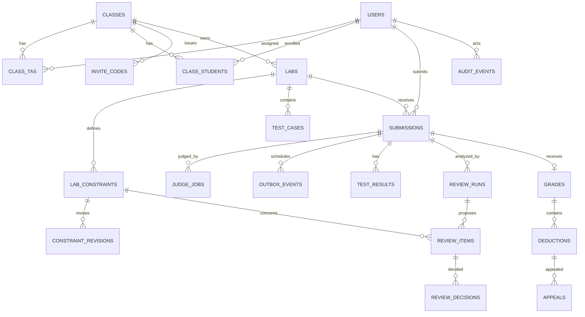

# LeeTKOB Database Design

## 1. Status and design goals

This is a proposed logical relational schema, not a migration specification. PostgreSQL is selected. BullMQ on Redis is selected for worker queues, with a PostgreSQL transactional outbox as the durable dispatch source. Migration tooling remains to be selected. The design supports class-scoped authorization, private tests, durable judging, counted-submission selection, review/audit history, publication, and appeals. API DTOs remain separate from database rows.

The ownership column identifies which module owns writes and invariants. Other modules use narrow service interfaces; they do not query another module's tables directly. Shared database transactions may coordinate module-owned repositories for explicitly documented workflows.

## 2. Logical ER diagram

`REVIEW_DECISIONS` and `GRADES` may be represented with different physical shapes if implementation requires it; the logical invariant and history requirements take precedence. Exact IDs (integer vs UUID), timestamp precision, enum representation, and JSON usage are open until adapter selection.

## 3. Proposed table catalog

| Table                  | Owner             | Purpose and key rules                                                                                                                                                                                  |
| ---------------------- | ----------------- | ------------------------------------------------------------------------------------------------------------------------------------------------------------------------------------------------------ |
| `users`                | Auth/Identity     | Stable user ID, display name, role (`admin`, `ta`, `student`), account status, identity-provider subject or credential reference. Do not store plaintext credentials. Role changes are audited.        |
| `classes`              | Classes           | Class identifier, name, and created/updated timestamps. Class archive behavior is not part of the initial product scope.                                                                                |
| `class_tas`            | Classes           | Class/TA assignment history with assigning actor/time; only one active `(class_id, ta_user_id)` assignment.                                                                                            |
| `class_students`       | Classes           | Student membership history with join source/time; only one active `(class_id, student_user_id)` membership.                                                                                            |
| `invite_codes`         | Classes           | Class, keyed hash of secret code, creation/expiry/revocation metadata, creator. Never store/log usable plaintext after response. Unique active code hash.                                              |
| `labs`                 | Labs              | Owning class, title, statement, open/deadline timestamps, lifecycle/publication fields, frozen grading inputs (constraints, tests, limits) after opening, created/updated actor/time.                 |
| `lab_constraints`      | Labs              | Stable constraint ID within a lab, current text/deduction, active flag and revision pointer. Deduction is 0.01–10.00 with two decimal places; score is capped at zero.                                |
| `constraint_revisions` | Labs              | Immutable pre-open revision history with old/new text and deduction, actor/time, and optional reason. Required to explain the rule version used for review.                                            |
| `test_cases`           | Labs              | Ordered TA-private input/expected output, resource metadata if needed. Never selected by student projections. Default limits are 100 tests, 256 KiB combined input/output per test, 10 MiB total lab test payload. |
| `submissions`          | Submissions       | Lab, student, source or protected source reference, server receipt time, judge status, overall verdict, source size/hash. Ordering index supports latest received before deadline.                     |
| `judge_jobs`           | Judging           | Durable work state, submission ID, attempt/lease timestamps, safe error category and completion. Unique job identity prevents duplicate enqueue for the same submission workflow.                      |
| `test_results`         | Judging           | Submission/test ordinal, verdict, execution time and safe resource metrics. Unique `(submission_id, test_number)`; no student-readable input/output fields.                                            |
| `review_runs`          | Constraint Review | Submission, constraint revision set, processing status/time, model usage/cost and safe failure/unsure reason. Retry/attempt history must be retained sufficiently for audit/cost accounting.           |
| `review_items`         | Constraint Review | One submission/constraint proposal, proposed `pass`/`violation`/`unsure`, evidence, sampling flag, queue state, source revision/run. Unique per counted submission and applicable constraint revision. |
| `review_decisions`     | Reviews/Grades    | Final TA `pass` or `violation`, reason, evidence, actor/time, and superseded decision reference where TA changes a decision. A violation requires one or more exact source lines.                      |
| `grades`               | Reviews/Grades    | One current grade per class student/lab; attach the counted submission when one exists, otherwise record the automatic zero for no valid pre-deadline submission. Preserve adjustment history.       |
| `deductions`           | Reviews/Grades    | Confirmed constraint deduction, constraint/revision, amount, reason and evidence. Unique active deduction per grade/constraint; multiple evidence lines do not multiply the deduction.                 |
| `grade_adjustments`    | Reviews/Grades    | Before/after score, reason, actor/time, source (`appeal`, manual correction, optional non-AC score), and related appeal if applicable.                                                                 |
| `lab_publications`     | Reviews/Grades    | One first publication event/time/actor per lab. Unique lab key supports idempotent publish response. No unpublish state.                                                                               |
| `appeals`              | Appeals           | Student, deduction, explanation, pending/accepted/rejected status, creation time and one final decision/reason/actor/time. Unique `(deduction_id)` enforces one appeal per deduction.                  |
| `audit_events`         | Audit             | Actor, time, entity type/ID, action, safe before/after values, request/correlation ID. Append-only application behavior; redact secrets/source unless a specific retention need is approved.           |
| `outbox_events`        | Infrastructure    | Transactional work records inserted with domain changes, then dispatched idempotently to BullMQ/Redis. PostgreSQL remains authoritative if Redis loses queue state.                              |

## 4. Important constraints and indexing policy

Proposed constraints (translate to the selected database's syntax):

- Foreign keys for all owned relationships; prevent deleting referenced labs/users where deletion would erase audit history.
- Unique memberships and TA assignments; unique constraint ID within a lab; unique test ordinal per lab.
- `opens_at < deadline_at`; allowed execution limit ranges from FAQ-05.
- Source size check at intake (64 KB), with the service rejecting oversize input before a submission record is created.
- Score between 0 and 10; deduction amount is nonnegative and bounded by the lab's decision once its allowable precision/range is finalized.
- A lab has at most one first-publication record; publication time is immutable.
- One appeal per confirmed deduction; one final active decision per review item, with superseded decisions retained.
- Unique test result per submission/test ordinal and idempotent judge job identifier.

The detailed proposed indexes are listed with each table in §7. Evaluate these against actual queries before creating migrations:

- `class_tas(ta_user_id, class_id)` and `class_students(student_user_id, class_id)` for ownership checks.
- `labs(class_id, opens_at, deadline_at)` for class lab lists and lifecycle selection.
- `submissions(lab_id, student_id, received_at DESC)` for latest submission; `submissions(lab_id, received_at)` for batch review processing.
- `judge_jobs(status, available_at, created_at)` for worker claims (possibly partial index for runnable states).
- `outbox_events(status, available_at, outbox_event_id)` for pending dispatch.
- `review_items(lab_id, queue_status, created_at)` for TA queues; `review_items(submission_id, constraint_id)` for uniqueness/lookup.
- `appeals(status, created_at)` and `appeals(decision_actor_id, decided_at)` for TA work/audit.
- `audit_events(entity_type, entity_id, created_at)` and `(actor_id, created_at)` for traceability.

Avoid indexing source, test input/output, or high-volume JSON fields without measured need. Partitioning remains an operational choice; source retention follows §6, while prompt/model-response and audit retention require the course-record policy.

## 5. Transaction boundaries

| Workflow                  | Required invariant                                                                                                                | Proposed transaction strategy                                                                                                                         |
| ------------------------- | --------------------------------------------------------------------------------------------------------------------------------- | ----------------------------------------------------------------------------------------------------------------------------------------------------- |
| Accept submission         | A successful acknowledgement corresponds to a persisted submission and durable judge work; late/oversize attempts create neither. | Insert submission and outbox row atomically; dispatch after commit to BullMQ with a stable job ID. Receipt timestamp is captured once by server clock. |
| Complete judge job        | Retry does not create duplicate per-test outcomes or a second final state.                                                        | Update job with expected state/lease token; upsert results under unique keys; commit state and results together.                                      |
| Select counted submission | Greatest receipt timestamp before deadline is counted regardless of verdict; equal timestamps use greater submission ID.          | Query/order by `received_at DESC, submission_id DESC` after deadline; persist selection or make it reproducible.                                      |
| Edit grading inputs       | Edits are allowed only while the lab is scheduled; grading inputs freeze at opening.                                               | Update constraint revisions and tests before opening. No post-open edit/re-review flow is included in this project's scope.                         |
| Record TA decision        | Decision, evidence, queue completion, and audit event agree.                                                                      | Commit the decision and audit record together; retain superseded decisions on changes.                                                                |
| Publish lab               | Deadline passed; all valid submissions judged successfully; counted Accepted work fully reviewed; no required TA decision pending; replay returns original timestamp. | Lock/compare lab state, judge/review job states, counted submissions and pending decisions; insert unique publication once and audit in one transaction. |
| Accept appeal             | Accepted appeal removes only its deduction and adjusts the score exactly once.                                                    | Lock appeal/deduction/grade, persist decision, adjustment, deduction state and audit atomically.                                                      |

Queue delivery is at-least-once. The outbox dispatcher may enqueue the same stable job ID more than once if it crashes between enqueue and acknowledgement; unique keys and state checks make dispatch and worker handling idempotent. PostgreSQL job state can reconstruct BullMQ work after Redis loss.

## 6. Privacy and retention

Source and hidden test data are sensitive course data. Protect at rest and in transit using PostgreSQL/platform encryption; restrict database access by service role. Public API projections must never expose test cases or another student's source. Model input is derived in memory after comment/identity stripping; persist only what is needed for audit, debugging, and course policy. Retain full submission source until 90 days after the seven-day appeal window closes (97 days after publication); do not purge unpublished submissions or submissions with an unresolved eligible appeal. Prompt, model-response, and audit retention periods still need a course-record policy. Never store API keys in these tables.

## 7. Proposed columns and indexes

The definitions below make the logical design concrete using PostgreSQL types. They are a reviewable proposal, not approved DDL. Use `UUID DEFAULT gen_random_uuid()` for internal IDs and `TIMESTAMPTZ` for instants. Set `created_at` values using the injected server clock. Apply foreign keys with `ON DELETE RESTRICT` for records needed by audit/grade history. Prefer soft deactivation over deleting users or classes. Every primary key has its database-created primary-key index; the table sections list additional unique and query indexes.

### 7.1 `users` — Auth/Identity

| Column | Type | Null | Rules / meaning |
|---|---|---:|---|
| `user_id` | `UUID` | No | Primary key. |
| `identity_subject` | `VARCHAR(255)` | No | Stable subject from the selected identity provider; unique. Never a bearer token. |
| `display_name` | `VARCHAR(160)` | No | Safe user-facing name. |
| `role` | `VARCHAR(16)` | No | Check: `admin`, `ta`, `student`. |
| `account_status` | `VARCHAR(16)` | No | Check: `active`, `disabled`; default `active`. |
| `created_at` | `TIMESTAMPTZ` | No | Account record creation time. |
| `updated_at` | `TIMESTAMPTZ` | No | Last profile/role/status change. |

**Indexes:** unique `users(identity_subject)`; optional `users(role, account_status)` only if admin account filters are implemented. The primary key index is implicit.

### 7.2 `classes` — Classes

| Column | Type | Null | Rules / meaning |
|---|---|---:|---|
| `class_id` | `UUID` | No | Primary key. |
| `name` | `VARCHAR(120)` | No | Trimmed class name; exact uniqueness policy is open. |
| `created_by_user_id` | `UUID` | No | FK to `users.user_id`; creator must be admin at write time. |
| `created_at` | `TIMESTAMPTZ` | No | Creation time. |
| `updated_at` | `TIMESTAMPTZ` | No | Last class metadata change. |
| `archived_at` | `TIMESTAMPTZ` | Yes | Reserved for a future archive capability; no class archive endpoint is in initial scope. |

**Indexes:** `classes(created_by_user_id, created_at DESC)` for admin-created class lookup if needed; primary key is implicit. Add a unique normalized-name index only if class-name uniqueness is approved.

### 7.3 `class_tas` — Classes

| Column | Type | Null | Rules / meaning |
|---|---|---:|---|
| `class_ta_id` | `UUID` | No | Primary key, permits historical assignment rows. |
| `class_id` | `UUID` | No | FK to `classes`. |
| `ta_user_id` | `UUID` | No | FK to `users`; user role must be TA when assigned. |
| `assigned_by_user_id` | `UUID` | No | FK to `users`; admin actor. |
| `assigned_at` | `TIMESTAMPTZ` | No | Assignment time. |
| `revoked_at` | `TIMESTAMPTZ` | Yes | Null while active; preserve history on removal. |

**Indexes:** unique `(class_id, ta_user_id) WHERE revoked_at IS NULL`; `(ta_user_id, class_id) WHERE revoked_at IS NULL` for TA ownership checks; `(assigned_by_user_id, assigned_at)` for audit lookup.

### 7.4 `class_students` — Classes

| Column | Type | Null | Rules / meaning |
|---|---|---:|---|
| `class_student_id` | `UUID` | No | Primary key, permits historical membership rows. |
| `class_id` | `UUID` | No | FK to `classes`. |
| `student_user_id` | `UUID` | No | FK to `users`; role must be student at enrollment. |
| `joined_at` | `TIMESTAMPTZ` | No | Membership start. |
| `joined_via` | `VARCHAR(16)` | No | Check: `invite`, `staff`; records enrollment source. |
| `joined_by_user_id` | `UUID` | Yes | FK to `users`; null for self-service invite join, staff actor otherwise. |
| `left_at` | `TIMESTAMPTZ` | Yes | Null while active; preserve prior membership history if re-enrollment is permitted. |

**Indexes:** unique `(class_id, student_user_id) WHERE left_at IS NULL`; `(student_user_id, class_id) WHERE left_at IS NULL` for membership checks; `(joined_by_user_id, joined_at)` for staff enrollment audit.

### 7.5 `invite_codes` — Classes

| Column | Type | Null | Rules / meaning |
|---|---|---:|---|
| `invite_code_id` | `UUID` | No | Primary key. |
| `class_id` | `UUID` | No | FK to `classes`. |
| `code_hash` | `BYTEA` | No | Keyed digest of generated code; plaintext is returned once and never stored. |
| `created_by_user_id` | `UUID` | No | FK to `users`; admin or assigned TA. |
| `created_at` | `TIMESTAMPTZ` | No | Creation time. |
| `expires_at` | `TIMESTAMPTZ` | No | Exactly 30 days after creation. |
| `revoked_at` | `TIMESTAMPTZ` | Yes | Null while usable. |

**Indexes:** unique `invite_codes(code_hash)`; `(class_id, created_at DESC)` for rotation history; unique partial `(class_id) WHERE revoked_at IS NULL` for one active code per class. Generate high-entropy codes and store keyed hashes; key management belongs in deployment secrets.

### 7.6 `labs` — Labs

| Column | Type | Null | Rules / meaning |
|---|---|---:|---|
| `lab_id` | `UUID` | No | Primary key. |
| `class_id` | `UUID` | No | FK to `classes`. |
| `title` | `VARCHAR(160)` | No | Non-empty trimmed title. |
| `statement` | `TEXT` | No | Lab instructions. |
| `opens_at` | `TIMESTAMPTZ` | No | Must be earlier than `deadline_at`. |
| `deadline_at` | `TIMESTAMPTZ` | No | Submission boundary; receipt at equality is late. |
| `cpu_seconds` | `SMALLINT` | No | FAQ-05 range 1–5; default 1. |
| `memory_mb` | `SMALLINT` | No | FAQ-05 range 64–512; default 256. |
| `created_by_user_id` | `UUID` | No | FK to `users`; assigned TA at creation. |
| `created_at` | `TIMESTAMPTZ` | No | Creation time. |
| `updated_by_user_id` | `UUID` | No | FK to `users`; most recent editor. |
| `updated_at` | `TIMESTAMPTZ` | No | Last modification time. |

Lab status is derived: `scheduled` before `opens_at`, `open` from `opens_at` until `deadline_at`, `closed` at/after the deadline, and `published` after the publication record exists. Labs are created with a schedule, may be edited only while scheduled, and have no delete operation in the initial product scope.

**Indexes:** `(class_id, opens_at, lab_id)` for class lab lists; `(deadline_at, lab_id)` for due-lab processing; `(created_by_user_id, created_at DESC)` for TA-created labs. Consider a partial deadline index only if measured worker queries need it.

### 7.7 `lab_constraints` — Labs

| Column | Type | Null | Rules / meaning |
|---|---|---:|---|
| `constraint_id` | `VARCHAR(40)` | No | Stable lab-local ID such as `C1`; part of primary key with `lab_id`. |
| `lab_id` | `UUID` | No | FK to `labs`; part of primary key. |
| `current_revision_id` | `UUID` | Yes | FK to current `constraint_revisions` row; null only during initial creation transaction. |
| `is_active` | `BOOLEAN` | No | False after removal; retain record for history. |
| `created_at` | `TIMESTAMPTZ` | No | Initial definition time. |

The current text and deduction are read from the referenced immutable revision, avoiding a second mutable copy. A later implementation may denormalize them for performance only if it preserves revision consistency transactionally.

**Indexes:** primary key `(lab_id, constraint_id)`; `(lab_id, is_active, constraint_id)` for current lab view; unique revision pointer is not required because a revision may be referenced by its owner only.

### 7.8 `constraint_revisions` — Labs

| Column | Type | Null | Rules / meaning |
|---|---|---:|---|
| `constraint_revision_id` | `UUID` | No | Primary key. |
| `lab_id` | `UUID` | No | FK to `labs`. |
| `constraint_id` | `VARCHAR(40)` | No | FK to `lab_constraints(lab_id, constraint_id)`. |
| `revision_number` | `INTEGER` | No | Starts at 1; unique within constraint. |
| `text` | `TEXT` | No | Exact wording for this review version. |
| `deduction` | `NUMERIC(4,2)` | No | Range 0.01–10.00; values are points on the 10-point lab scale. |
| `change_kind` | `VARCHAR(24)` | No | Check: `created`, `edited`, or `removed`; edits only occur before opening. |
| `changed_by_user_id` | `UUID` | No | FK to `users`. |
| `changed_at` | `TIMESTAMPTZ` | No | Revision time. |
| `change_reason` | `TEXT` | Yes | Optional TA explanation; whether required is open. |

**Indexes:** unique `(lab_id, constraint_id, revision_number)`; `(lab_id, changed_at DESC)` for history; `(constraint_id, revision_number DESC)` is unnecessary without `lab_id` because constraint IDs are lab-local.

### 7.9 `test_cases` — Labs

| Column | Type | Null | Rules / meaning |
|---|---|---:|---|
| `test_case_id` | `UUID` | No | Primary key. |
| `lab_id` | `UUID` | No | FK to `labs`. |
| `test_number` | `INTEGER` | No | One-based stable order, unique per lab. |
| `input_data` | `BYTEA` | No | Exact private stdin bytes; never student-readable. |
| `expected_output` | `BYTEA` | No | Exact expected output bytes; never student-readable. |
| `created_at` | `TIMESTAMPTZ` | No | Creation time. |
| `updated_at` | `TIMESTAMPTZ` | No | Last edit time. |

**Indexes:** unique `(lab_id, test_number)`; `(lab_id, test_case_id)` for judge bundle reads. Do not index input/output contents. Enforce at most 100 tests, at most 256 KiB combined input/output per test, and at most 10 MiB total per lab.

### 7.10 `submissions` — Submissions

| Column | Type | Null | Rules / meaning |
|---|---|---:|---|
| `submission_id` | `UUID` | No | Primary key. |
| `lab_id` | `UUID` | No | FK to `labs`. |
| `student_user_id` | `UUID` | No | FK to `users`; derived from authenticated principal. |
| `idempotency_key` | `VARCHAR(128)` | No | Scoped to `(lab_id, student_user_id)`; same key/source replays the original submission, same key/different source conflicts. |
| `request_sha256` | `CHAR(64)` | No | Hash of exact source bytes for idempotency payload comparison. |
| `source_code` | `BYTEA` | No | Exact UTF-8 source bytes in PostgreSQL; access restricted to authorized TA, judge, and review workflows. |
| `source_bytes` | `INTEGER` | No | 1–65,536; validated before insert. |
| `source_sha256` | `CHAR(64)` | No | Lowercase hex digest for integrity/idempotency diagnostics, not identity. |
| `received_at` | `TIMESTAMPTZ` | No | Captured once from server clock, strictly before deadline. |
| `judge_status` | `VARCHAR(16)` | No | Check: `queued`, `running`, `finished`, `failed`. |
| `overall_verdict` | `VARCHAR(8)` | Yes | `AC`, `WA`, `TLE`, `MLE`, `RE`, `CE`; null until known. |
| `judge_completed_at` | `TIMESTAMPTZ` | Yes | Null until terminal judge result. |

**Indexes:** unique `(lab_id, student_user_id, idempotency_key)` for submission retries; `(lab_id, student_user_id, received_at DESC, submission_id DESC)` for latest submission; `(lab_id, received_at, submission_id)` for post-deadline batch selection; `(student_user_id, received_at DESC)` for own history; `(judge_status, received_at)` for worker queries and stream snapshots. Equal receipt timestamps are ordered by descending `submission_id`.

### 7.11 `judge_jobs` — Judging

| Column | Type | Null | Rules / meaning |
|---|---|---:|---|
| `judge_job_id` | `UUID` | No | Primary key. |
| `submission_id` | `UUID` | No | FK to `submissions`; unique for the initial judge run. |
| `status` | `VARCHAR(16)` | No | Check: `queued`, `running`, `succeeded`, `retryable`, `failed`. |
| `attempt_count` | `INTEGER` | No | Default 0; nonnegative. |
| `available_at` | `TIMESTAMPTZ` | No | Earliest retry/claim time. |
| `lease_owner` | `VARCHAR(160)` | Yes | Worker ID while claimed. |
| `lease_expires_at` | `TIMESTAMPTZ` | Yes | Claim expiry for crash recovery. |
| `last_error_code` | `VARCHAR(64)` | Yes | Safe internal category only; no raw stack/provider details. |
| `created_at` | `TIMESTAMPTZ` | No | Enqueue time. |
| `updated_at` | `TIMESTAMPTZ` | No | State change time. |
| `completed_at` | `TIMESTAMPTZ` | Yes | Terminal completion time. |

**Indexes:** unique `(submission_id)` for one initial judge job; `(available_at, judge_job_id) WHERE status IN ('queued','retryable')` for runnable jobs; `(lease_expires_at, judge_job_id) WHERE status = 'running'` for expired-lease recovery. If rejudge is later supported, replace the unique key with `(submission_id, run_number)`.

### 7.12 `test_results` — Judging

| Column | Type | Null | Rules / meaning |
|---|---|---:|---|
| `test_result_id` | `UUID` | No | Primary key. |
| `submission_id` | `UUID` | No | FK to `submissions`. |
| `test_number` | `INTEGER` | No | Corresponds to lab test ordinal. |
| `verdict` | `VARCHAR(8)` | No | Check: `AC`, `WA`, `TLE`, `MLE`, `RE`, `CE`. |
| `execution_ms` | `INTEGER` | Yes | Nonnegative safe metric. |
| `memory_kb` | `INTEGER` | Yes | Nonnegative safe metric if runner provides it. |
| `created_at` | `TIMESTAMPTZ` | No | Result persistence time. |

**Indexes:** unique `(submission_id, test_number)`; `(submission_id, test_number)` also serves ordered result reads. Do not persist test input, expected output, or raw stdout/stderr here.

### 7.13 `review_runs` — Constraint Review

| Column | Type | Null | Rules / meaning |
|---|---|---:|---|
| `review_run_id` | `UUID` | No | Primary key. |
| `submission_id` | `UUID` | No | FK to `submissions`; must correspond to counted Accepted work for final run. |
| `attempt_number` | `INTEGER` | No | Positive run/attempt number. |
| `status` | `VARCHAR(16)` | No | Check: `queued`, `running`, `completed`, `partial`, `failed`. |
| `method_summary` | `VARCHAR(16)` | No | E.g. `hard_rule`, `model`, `mixed`; precise vocabulary to finalize. |
| `provider_name` | `VARCHAR(120)` | Yes | Provider identifier, never credential. |
| `model_name` | `VARCHAR(160)` | Yes | Model version/name for audit. |
| `input_tokens` | `INTEGER` | Yes | Nonnegative if provider reports usage. |
| `output_tokens` | `INTEGER` | Yes | Nonnegative if provider reports usage. |
| `cost_usd` | `NUMERIC(10,6)` | Yes | Nonnegative measured/estimated cost. |
| `failure_code` | `VARCHAR(64)` | Yes | Safe category such as timeout/schema/budget/provider failure. |
| `started_at` | `TIMESTAMPTZ` | Yes | Run start. |
| `completed_at` | `TIMESTAMPTZ` | Yes | Run completion. |
| `created_at` | `TIMESTAMPTZ` | No | Durable run creation. |

**Indexes:** `(submission_id, attempt_number)` unique; `(status, created_at)` for workers; `(submission_id, created_at DESC)` for history; `(provider_name, created_at)` for cost reporting. Full prompts and raw provider responses are intentionally omitted from the baseline schema.

### 7.14 `review_items` — Constraint Review

| Column | Type | Null | Rules / meaning |
|---|---|---:|---|
| `review_item_id` | `UUID` | No | Primary key. |
| `review_run_id` | `UUID` | No | FK to `review_runs`. |
| `submission_id` | `UUID` | No | FK to `submissions`. |
| `lab_id` | `UUID` | No | FK to `labs`; denormalized for queue lookup, validate against submission. |
| `constraint_id` | `VARCHAR(40)` | No | FK to `lab_constraints(lab_id, constraint_id)`. |
| `constraint_revision_id` | `UUID` | No | FK to exact `constraint_revisions` reviewed. |
| `proposed_verdict` | `VARCHAR(12)` | No | Check: `pass`, `violation`, `unsure`. |
| `proposal_reason` | `TEXT` | Yes | Safe summary/reason for TA, particularly required for unsure. |
| `evidence` | `JSONB` | No | Array of `{line, text}`; validate exact source correspondence in service. Default empty array. |
| `queue_status` | `VARCHAR(12)` | No | Check: `pending` or `resolved`; pending required item blocks publish. |
| `sampled_pass` | `BOOLEAN` | No | True only when a pass was included in the TA sample; never student-visible. |
| `created_at` | `TIMESTAMPTZ` | No | Proposal creation time. |

**Indexes:** `(lab_id, queue_status, created_at, review_item_id)` for TA queue; unique `(submission_id, constraint_id, constraint_revision_id, review_run_id)` to prevent duplicate item creation per run; `(submission_id, constraint_id, created_at DESC)` for review history; partial `(lab_id, created_at) WHERE queue_status = 'pending'` for publish-gate count.

### 7.15 `review_decisions` — Reviews/Grades

| Column | Type | Null | Rules / meaning |
|---|---|---:|---|
| `review_decision_id` | `UUID` | No | Primary key. |
| `review_item_id` | `UUID` | No | FK to `review_items`. |
| `sequence_number` | `INTEGER` | No | Monotonic per review item. |
| `verdict` | `VARCHAR(12)` | No | Check: final `pass` or `violation`; never `unsure`. |
| `reason` | `TEXT` | No | TA explanation; maximum contract length applies. |
| `evidence` | `JSONB` | No | Exact 1-based code line evidence for violation; empty for pass. |
| `decided_by_user_id` | `UUID` | No | FK to `users`; must be assigned TA. |
| `decided_at` | `TIMESTAMPTZ` | No | Decision time. |
| `is_current` | `BOOLEAN` | No | Only latest decision is current; prior decisions remain for audit. |

**Indexes:** unique `(review_item_id, sequence_number)`; unique partial `(review_item_id) WHERE is_current`; `(decided_by_user_id, decided_at DESC)` for TA audit; `(review_item_id, decided_at DESC)` for history.

### 7.16 `grades` — Reviews/Grades

Proposed granularity: one grade per class student/lab, attached to the counted submission when present. Students without a valid pre-deadline submission, including students enrolled after the deadline or after publication, receive an automatic zero in the published result projection. The projection must include a derived zero for later class members even if no grade row existed at initial publication.

| Column | Type | Null | Rules / meaning |
|---|---|---:|---|
| `grade_id` | `UUID` | No | Primary key. |
| `lab_id` | `UUID` | No | FK to `labs`. |
| `student_user_id` | `UUID` | No | FK to `users`. |
| `submission_id` | `UUID` | Yes | FK to counted `submissions`; null only for automatic zero when the student has no valid pre-deadline submission. |
| `base_score` | `NUMERIC(4,2)` | No | Pre-deduction score: 10 for Accepted work; zero for non-AC and no-submission cases. |
| `score` | `NUMERIC(4,2)` | No | Current score 0–10; precision should match finalized scoring rule. |
| `grade_source` | `VARCHAR(24)` | No | Check: `accepted_formula`, `non_ac_default`, `no_submission_default`. |
| `updated_at` | `TIMESTAMPTZ` | No | Last score calculation/adjustment. |
| `updated_by_user_id` | `UUID` | Yes | FK to `users`; null for automated calculation, TA for manual/correction. |

**Indexes:** unique `(lab_id, student_user_id)`; unique `(submission_id)`; `(lab_id, score, student_user_id)` for TA result aggregation after publication; `(student_user_id, lab_id)` is covered by the first unique index only with lab first, so add it if student result lookup is measured as a hot path.

### 7.17 `deductions` — Reviews/Grades

| Column | Type | Null | Rules / meaning |
|---|---|---:|---|
| `deduction_id` | `UUID` | No | Primary key. |
| `grade_id` | `UUID` | No | FK to `grades`. |
| `constraint_id` | `VARCHAR(40)` | No | Identifies the lab constraint. |
| `constraint_revision_id` | `UUID` | No | FK to revision that was active for the final review. |
| `amount` | `NUMERIC(4,2)` | No | Copied from lab constraint revision; applied once per constraint. |
| `reason` | `TEXT` | No | TA-confirmed student-facing reason. |
| `evidence` | `JSONB` | No | One or more exact lines; multiple lines do not multiply amount. |
| `is_active` | `BOOLEAN` | No | False after accepted appeal/correction removes it; preserve row. |
| `created_at` | `TIMESTAMPTZ` | No | Confirmation time. |
| `removed_at` | `TIMESTAMPTZ` | Yes | Time deduction was removed. |

**Indexes:** unique partial `(grade_id, constraint_id) WHERE is_active`; `(grade_id, is_active)` for score projection; `(constraint_revision_id)` for revision traceability. Constraint ID's lab scope is validated through grade's lab.

### 7.18 `grade_adjustments` — Reviews/Grades

| Column | Type | Null | Rules / meaning |
|---|---|---:|---|
| `grade_adjustment_id` | `UUID` | No | Primary key. |
| `grade_id` | `UUID` | No | FK to `grades`. |
| `appeal_id` | `UUID` | Yes | FK to `appeals`; null for a separate TA manual grade correction. |
| `adjustment_type` | `VARCHAR(24)` | No | Check: `appeal_accepted`, `manual_correction`. |
| `score_before` | `NUMERIC(4,2)` | No | Previous score. |
| `score_after` | `NUMERIC(4,2)` | No | New score, 0–10. |
| `reason` | `TEXT` | No | Required explanation. |
| `changed_by_user_id` | `UUID` | No | FK to `users`; assigned TA. |
| `created_at` | `TIMESTAMPTZ` | No | Adjustment time. |

**Indexes:** `(grade_id, created_at DESC)` for score history; `(changed_by_user_id, created_at DESC)` for audit; unique partial `(appeal_id) WHERE appeal_id IS NOT NULL` to prevent applying one accepted appeal twice.

### 7.19 `lab_publications` — Reviews/Grades

| Column | Type | Null | Rules / meaning |
|---|---|---:|---|
| `lab_id` | `UUID` | No | PK and FK to `labs`; at most one publication. |
| `published_by_user_id` | `UUID` | No | FK to `users`; assigned TA. |
| `published_at` | `TIMESTAMPTZ` | No | Immutable first publication time; returned on idempotent replay. |
| `created_at` | `TIMESTAMPTZ` | No | Persistence timestamp; normally equal to `published_at`. |

**Indexes:** primary key on `lab_id`; `(published_by_user_id, published_at DESC)` for TA history. No update/delete index or unpublish record is needed.

### 7.20 `appeals` — Appeals

| Column | Type | Null | Rules / meaning |
|---|---|---:|---|
| `appeal_id` | `UUID` | No | Primary key. |
| `deduction_id` | `UUID` | No | FK to `deductions`; unique, enforcing one appeal per deduction. |
| `student_user_id` | `UUID` | No | FK to `users`; must own the grade/submission. |
| `explanation` | `TEXT` | No | Non-empty student explanation. |
| `status` | `VARCHAR(12)` | No | Check: `pending`, `accepted`, `rejected`; default `pending`. |
| `created_at` | `TIMESTAMPTZ` | No | Must be at/after `published_at` and at/before `published_at + interval '7 days'`; equality at the upper boundary is eligible. |
| `decided_by_user_id` | `UUID` | Yes | FK to `users`; null while pending. |
| `decided_at` | `TIMESTAMPTZ` | Yes | Null while pending. |
| `decision_reason` | `TEXT` | Yes | Required when decided. |

**Indexes:** unique `(deduction_id)`; `(status, created_at, appeal_id)` for TA pending queue; `(student_user_id, created_at DESC)` for student's appeal history; `(decided_by_user_id, decided_at DESC)` for decision audit. Seven-day eligibility is validated against immutable `lab_publications.published_at` in the service/transaction.

### 7.21 `audit_events` — Audit

| Column | Type | Null | Rules / meaning |
|---|---|---:|---|
| `audit_event_id` | `UUID` | No | Primary key. |
| `actor_user_id` | `UUID` | Yes | FK to `users`; null only for a documented system actor. |
| `actor_kind` | `VARCHAR(16)` | No | Check: `user`, `system`; pair consistently with actor ID. |
| `entity_type` | `VARCHAR(64)` | No | Stable logical entity name. |
| `entity_id` | `VARCHAR(128)` | No | String form permits audit references across entity ID types. |
| `action` | `VARCHAR(64)` | No | Stable action key, e.g. `review.decision_recorded`. |
| `before_state` | `JSONB` | Yes | Safe, minimized values; never credentials/source by default. |
| `after_state` | `JSONB` | Yes | Safe, minimized values; never credentials/source by default. |
| `request_id` | `VARCHAR(128)` | Yes | HTTP/request correlation ID. |
| `workflow_id` | `VARCHAR(128)` | Yes | Submission/job/review workflow correlation. |
| `created_at` | `TIMESTAMPTZ` | No | Event time from injected clock. |

**Indexes:** `(entity_type, entity_id, created_at DESC)` for entity history; `(actor_user_id, created_at DESC)` for actor history; `(action, created_at DESC)` for operation audit; `(request_id)` and `(workflow_id)` where correlation lookups are needed. Retention/partitioning requires a policy decision and workload measurement.

### 7.22 `outbox_events` — Transactional Outbox

| Column | Type | Null | Rules / meaning |
|---|---|---:|---|
| `outbox_event_id` | `UUID` | No | Primary key and stable ordering key. |
| `event_key` | `VARCHAR(160)` | No | Unique logical job key; BullMQ uses it as the stable job ID. |
| `job_type` | `VARCHAR(32)` | No | `judge_submission` or `review_submission`. |
| `aggregate_id` | `UUID` | No | Submission or review workflow identifier; resolve payload through a domain service, not by exposing source in queue metadata. |
| `status` | `VARCHAR(16)` | No | `pending` or `dispatched`; transient failures remain pending with `available_at` and alert after repeated failures rather than dropping work. |
| `attempt_count` | `SMALLINT` | No | Dispatcher attempts; worker attempt state belongs to the job record. |
| `available_at` | `TIMESTAMPTZ` | No | Earliest dispatch time, supporting retry backoff. |
| `created_at` | `TIMESTAMPTZ` | No | Inserted in the same PostgreSQL transaction as the domain operation. |
| `dispatched_at` | `TIMESTAMPTZ` | Yes | Set after BullMQ accepts the stable job ID. |
| `last_failure_code` | `VARCHAR(64)` | Yes | Safe failure category only; no provider payload/source/secrets. |

**Indexes:** unique `(event_key)`; partial `(available_at, outbox_event_id) WHERE status = 'pending'` for dispatcher claims.

## 8. Decisions required before migrations

1. Select migration tooling for the chosen PostgreSQL database.
2. Define audit retention and query permissions under the course-record policy.
3. Confirm database table ownership with module contracts before finalizing schema.
